<!--
  Profile README. Everything between the cards markers is generated by scripts/render_cards.py
  (the daily workflow runs it), so edit the config block at the top of that script, not the block.
  Anything outside the markers is yours and is never touched.
  Preview the final frame locally:  STATIC=1 python scripts/render_cards.py  ->  preview/index.html
-->

<!-- cards:start -->

 

 

 

 

 

<!-- cards:end -->
